# BuzzRover

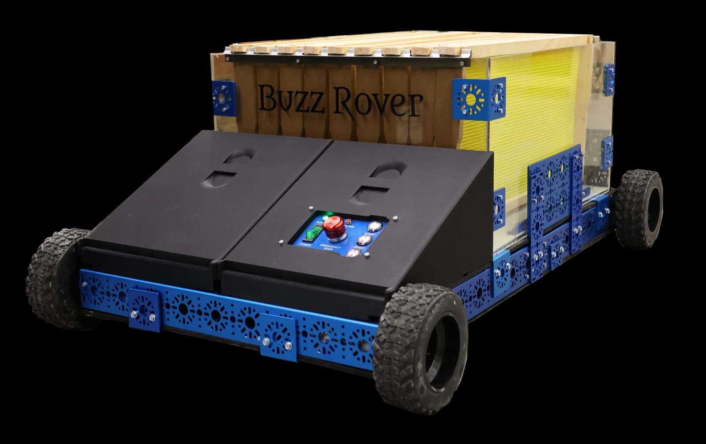

A remote-controlled transport rover that carries honey frames from the apiary to the extraction room at Willow Grove Heritage Bee & Egg Farm in Milton, Ontario. Built by a 10-student team from Abbey Park High School for the 2026 AgRobotics Student Challenge, where it placed 2nd.

A full honey super (9 frames) weighs 60 to 80 lb and was previously moved by hand on a cart. BuzzRover carries the frames in a removable plexiglass box on a skid-steer base, load-tested at 80 lb and demoed on-site at the farm.

This repo holds the rover's Java control code and the technical document (`docs/BuzzRover_TechnicalDocument.pdf`), which covers the design, wiring diagram, CAD, parts list and user instructions.

## Hardware

| Part | Details |
|---|---|
| Controller | Studica VMX Pi |
| Motor controller | Titan Quad, CAN ID 42 |
| Drive | 4 × Maverick 12 V DC gear motors with encoders, skid-steer |
| IMU | navX on the MXP SPI port |
| Chassis | Aluminum U-channel and L-beam frame, M3 hardware with Nyloc nuts, plywood top and bottom panels |
| Enclosure | Dual-lid 3D-printed ASA electronics hood with water-shedding lips and sliding-rail access |
| Payload | Removable plexiglass frame box that slides into aluminum side rails, 9-frame spacer |
| Operator input | PS4 controller on USB port 0 |

## Photos

| | |
|---|---|
| 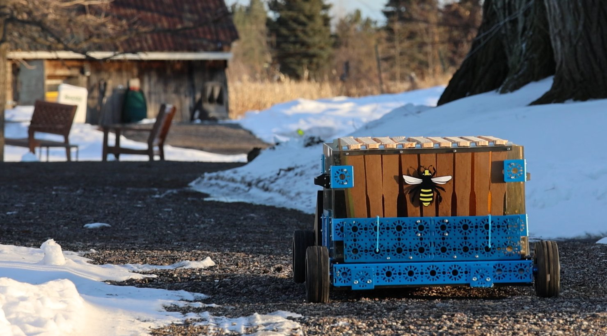 | 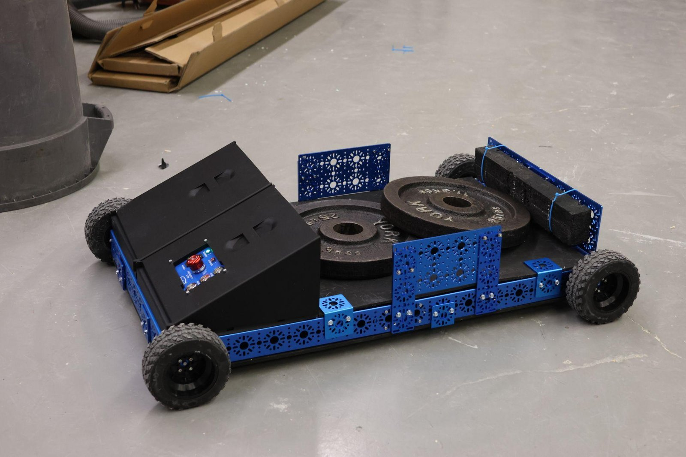 |
| On-site demo at Willow Grove | Load testing with weight plates |
| 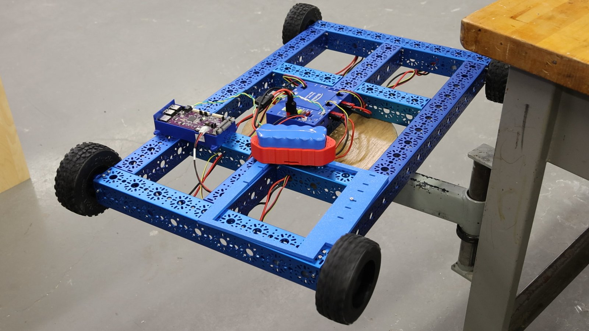 | 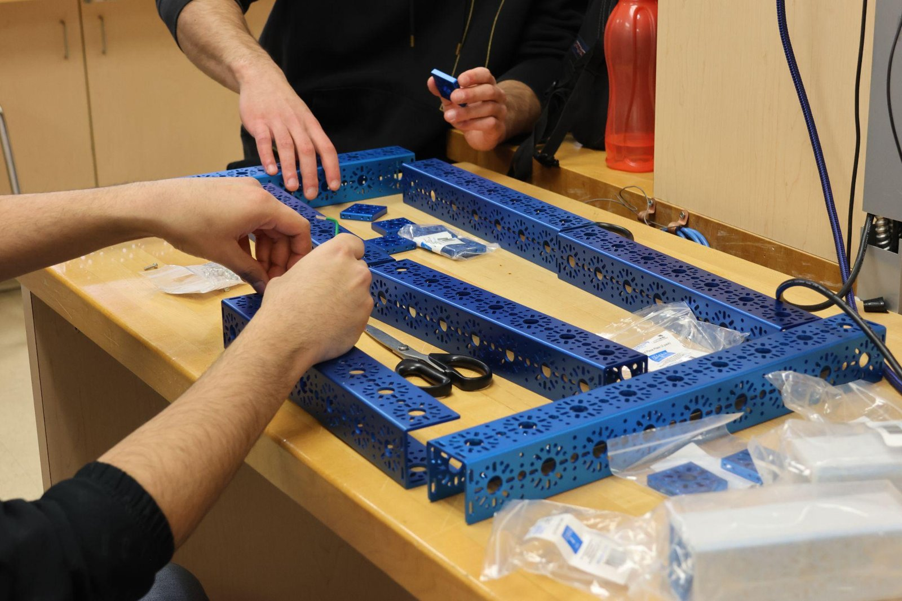 |
| Early chassis used to test the drive code | Assembling the aluminum chassis |

### CAD

| | |
|---|---|
| 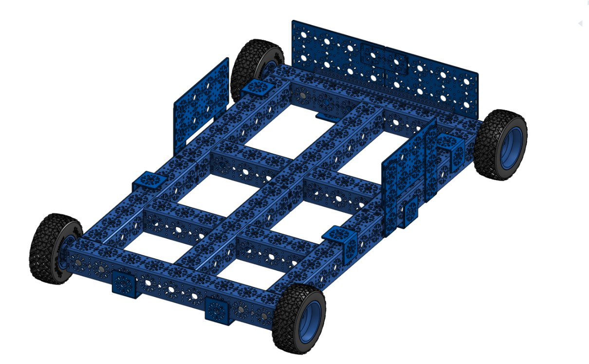 | 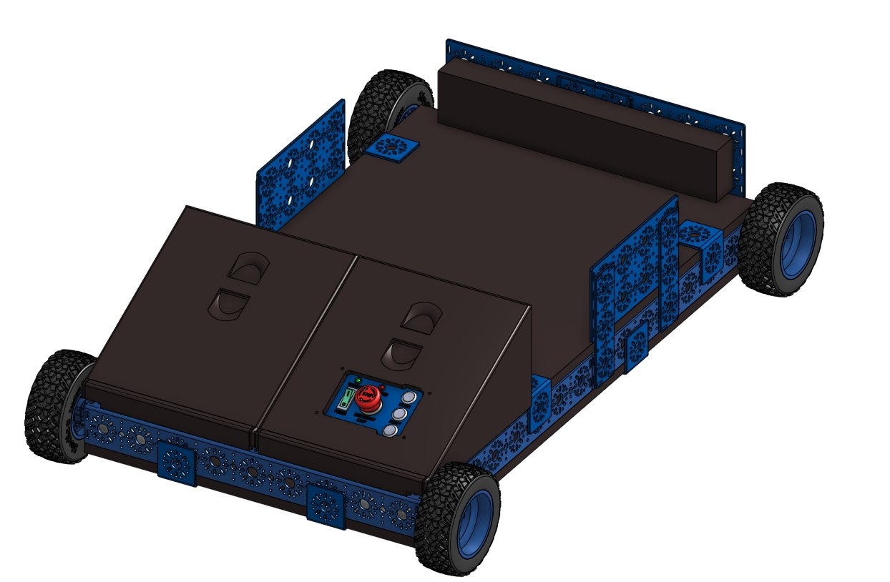 |
| Chassis frame | Frame with dual-lid electronics hood |
| 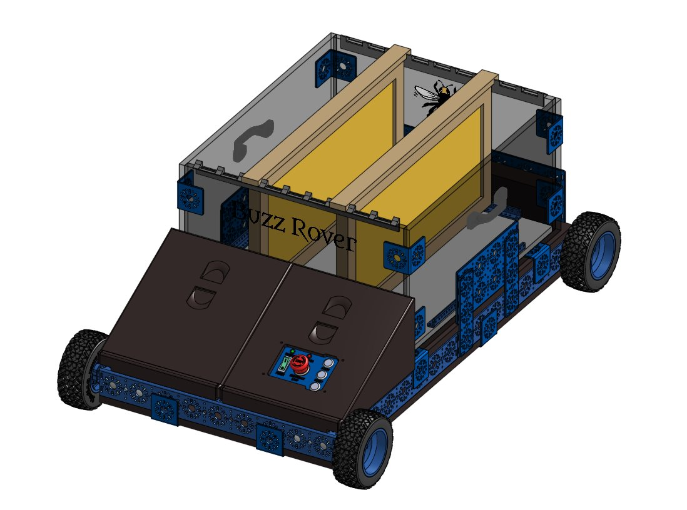 | 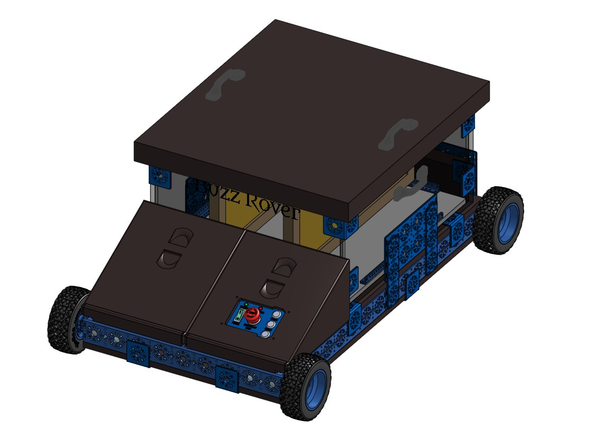 |
| Plexiglass frame box with honey frames | Complete rover with lid |
| 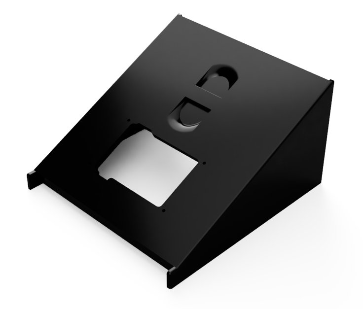 | 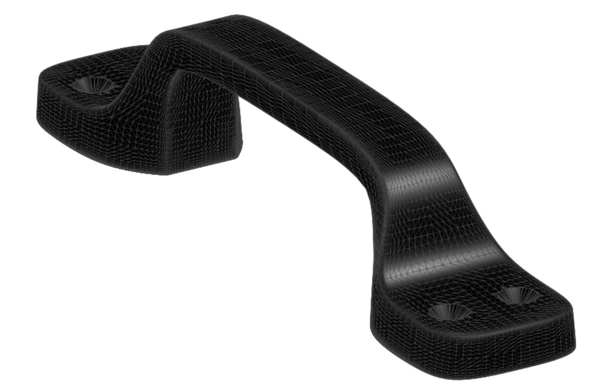 |
| Hood lid with control panel cutout | Printed lid handle |

### Electrical

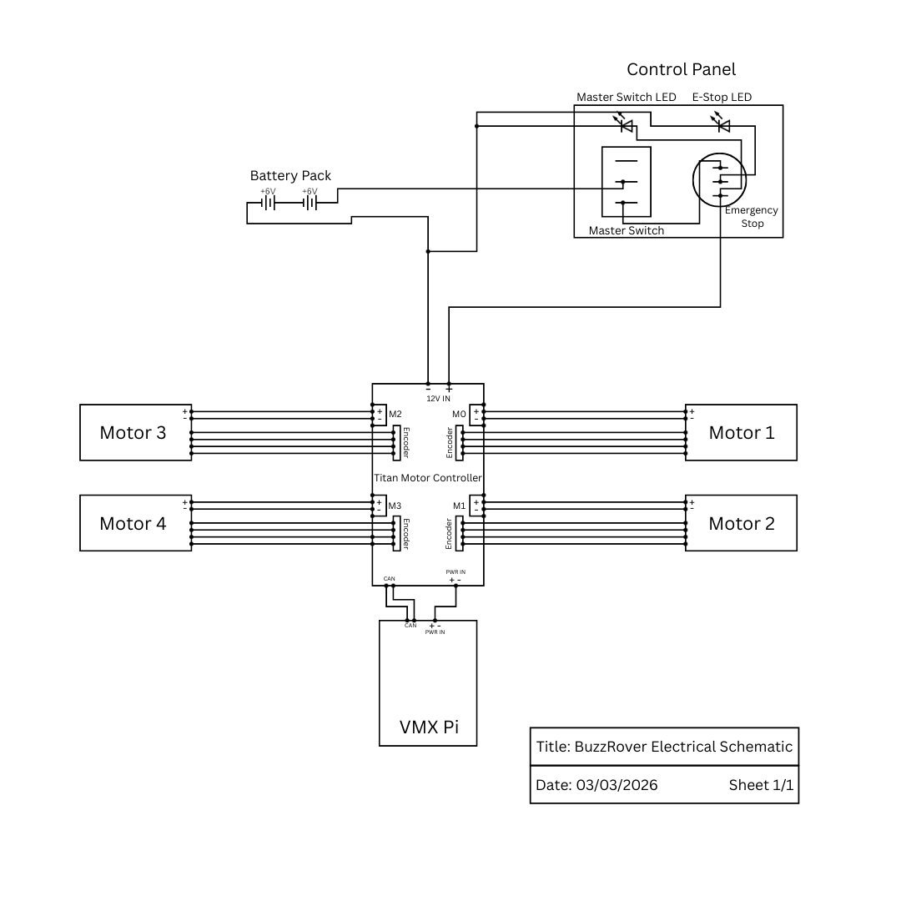

The battery pack feeds the Titan Quad through the control panel's master switch and emergency stop. The Titan drives all four motors and reads their encoders, and it talks to the VMX Pi over CAN.

## Software features

**Arcade drive.** The left stick drives the rover. `DriveTrain.driveArcade()` mixes forward and turn into left and right side power, clamped to [-1, 1], with a 0.06 joystick deadzone.

**Path record and replay.** The operator can record a drive and play it back later. While recording, `PathRecorder` stores the left and right motor power every 20 ms robot loop. Replay sends those samples back to the motors one per loop, so playback matches the original timing. There are 8 path slots.

**Persistent paths.** When a recording stops, the path is saved to `paths/path_<n>.json` in the robot's working directory (`/home/lvuser/paths/` on the VMX). All saved paths load on startup, so they survive power cycles.

**Stall detection.** During replay, if a sample is commanding the motors but the encoders move less than 0.5 between loops for 25 straight loops (0.5 s), replay stops so the rover doesn't burn battery pushing against an obstacle.

## Controls

| Input | Action |
|---|---|
| Left stick | Drive (arcade) |
| L1 / R1 | Previous / next path slot (only when not recording or replaying) |
| X (cross) | Start or stop recording on the current slot |
| Triangle | Start or stop replay of the current slot |

Status messages (slot changes, sample counts, path length, stall stops) print to the console.

## Code layout

```
src/main/java/frc/robot/
  Main.java, Robot.java      WPILib entry points
  RobotContainer.java        Creates DriveTrain and OI, sets Teleop as the default command
  Constants.java             CAN/motor IDs, deadzone, path and stall settings, encoder scaling
  commands/Teleop.java       Main loop: reads OI, drives, handles record/replay buttons
  gamepad/OI.java            Controller wrapper with deadzones
  gamepad/GamepadConstants.java  PS4 button and axis IDs
  subsystems/DriveTrain.java Motors, encoders, navX, arcade/tank drive, path recorder hooks
  utils/PathRecorder.java    Path slots, sampling, replay, stall check, JSON save/load
```

## Building and deploying

This is a GradleRIO project targeting the VMX Pi (`com.kauailabs.first.GradleRIO` 2020.3.2.30, Java 11) with the Studica and navX vendor libraries in `vendordeps/`. Set up the VMX toolchain following Studica's VMX Pi documentation, then run:

```
./gradlew build
./gradlew deploy
```

## Team and credits

Abbey Park High School team: Bora Chen, Joginder Dhaliwal, Duke Liu, Jad Mhanna, Lusako Mwakatobe, Jamie Peacock, Neel Shah, Ruvan Sidrake, Khelan Tailor, Sutong Zhang.

Ruvan Sidrake was team lead. He wired and hand-soldered the power distribution, control panel and motor harness, co-wrote the control code, designed the electronics hood in Onshape (with Bora Chen), and worked on the chassis and plexiglass housing.

Jamie Peacock was the main software author. The code was first published at [git.ozzyabc.xyz/AgRobotics](https://git.ozzyabc.xyz/AgRobotics) and is re-hosted here with his permission.

Rover CAD was done by Jad Mhanna and Khelan Tailor.

Community partner: Karin Tomosky, Willow Grove Heritage Bee & Egg Farm.
